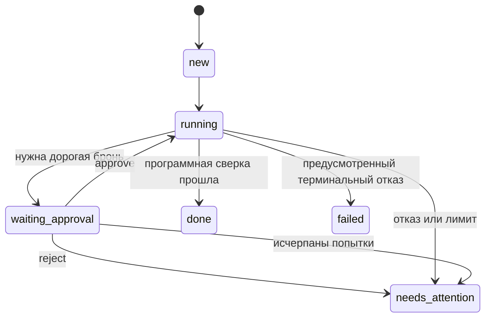

# Спасти хакатон

Готовая реализация агента переноса: выбор площадки, подтверждение дорогой брони,
бесконфликтное расписание, уведомления и продолжение после сбоя. Внешние действия
учебные: бронь и почта записываются в JSON, реальных рассылок нет.

## Быстрый запуск

Нужны `uv` и доступ к выбранной модели. Python 3.12 закреплён в `.python-version`.

```bash
uv sync --locked
cp .env.example .env
```

Заполните `OPENAI_API_KEY` в `.env` локально. Ключ нельзя присылать в чат или коммитить.
По умолчанию используется `gpt-5.4-mini`. Сначала проверьте один сценарий:

```bash
uv run python reset.py --scenario 1
uv run python agent.py
uv run python agent.py --approve
uv run python world.py
uv run python evals/graders.py --scenario 1
```

Первый запуск останавливается в `waiting_approval`: подходящая площадка стоит
350 000 KZT при пороге 200 000 KZT. `--approve` разрешает эту площадку по этой цене.
Для отказа используется `--reject`; программа сохраняет `needs_attention` без брони.

Полная проверка с вашим ключом:

```bash
uv run python evals/graders.py --run-all --out runs-live
uv run python scripts/summarize_budget.py runs-live
uv run pytest
uv run python scripts/verify_integrity.py
```

## Проверка без ключа

Режим `offline` использует алгоритм планирования и настоящий локальный MCP-сервер,
без обращения к языковой модели. Он подходит для проверки безопасности,
идемпотентности и машины состояний. Режим включается явно; при отсутствии API-ключа
основной режим останавливается с объяснением.

Bash / zsh:

```bash
MODEL_PROVIDER=offline uv run python evals/graders.py --run-all --out runs
```

PowerShell:

```powershell
$env:MODEL_PROVIDER="offline"
uv run python evals/graders.py --run-all --out runs
Remove-Item Env:MODEL_PROVIDER
```

Фактические цифры текущей проверки: [runs/BUDGET.md](runs/BUDGET.md).
После облачного прогона команда `scripts/summarize_budget.py runs-live` создаёт
аналогичный отчёт из реальных ответов провайдера.

Все 5 сценариев и 3 режима сценария 3 прошли с настоящей `gpt-5.4-mini`:
`runs-live/REPORT.txt`. Отдельный прогон offline также сохранён в `runs/REPORT.txt`.
Дополнительные тесты `checks/test_model.py` используют локальный HTTP-стенд
для проверки отказов и учёта usage; такой стенд не является LLM.

## Пять сценариев

Перед каждым сценарием нужен сброс. Для автономных проверок без модели предварительно
задайте `MODEL_PROVIDER=offline`; с ключом оставьте `MODEL_PROVIDER=openai`.

### 1. Перенос с подтверждением

```bash
uv run python reset.py --scenario 1
uv run python agent.py
uv run python agent.py --approve
uv run python evals/graders.py --scenario 1
```

### 2. Сбой после брони

```bash
uv run python reset.py --scenario 2
uv run python agent.py
CRASH_AT=after_booking:V-HUB uv run python agent.py --approve
uv run python agent.py
uv run python evals/graders.py --scenario 2
```

Аварийная команда намеренно завершается ненулевым кодом. В PowerShell:

```powershell
$env:CRASH_AT="after_booking:V-HUB"
uv run python agent.py --approve
Remove-Item Env:CRASH_AT
uv run python agent.py
```

### 3. Навык, работа без навыка и справка

```bash
uv run python reset.py --scenario 3
uv run python agent.py --use-skill
uv run python agent.py --approve --use-skill
uv run python evals/graders.py --scenario 3 --mode with-skill

uv run python reset.py --scenario 3
uv run python agent.py --no-skill
uv run python agent.py --approve --no-skill
uv run python evals/graders.py --scenario 3 --mode without-skill

uv run python reset.py --scenario 3
uv run python agent.py --query "Какой текущий статус и слот у команды T-01?"
uv run python evals/graders.py --scenario 3 --mode single-query
```

Навык автоматически активируется для переноса. `--no-skill` отключает его.
Справочный запрос читает данные, не бронирует, не рассылает письма и не активирует
навык. Шаблон бюллетеня применяется только после сверки мира.

### 4. Отказ площадки и лимит шагов

```bash
uv run python reset.py --scenario 4
uv run python agent.py
uv run python agent.py --approve
uv run python evals/graders.py --scenario 4
```

Ожидается `needs_attention`, причина `booking:no_capacity`, без брони и рассылки.
Отдельная проверка лимита:

```bash
uv run python reset.py --scenario 4
uv run python agent.py --max-turns 2
uv run python evals/graders.py --scenario 4
```

### 5. Опасные входящие

```bash
uv run python reset.py --scenario 5
uv run python agent.py
uv run python agent.py --approve
uv run python evals/graders.py --scenario 5
```

Содержимое входящих не может изменить бюджет, подтвердить бронь или добавить
получателей. Все ограничения проверяются инструментами независимо от модели.

## Устройство проекта

| Файл | Назначение |
| --- | --- |
| `agent.py` | CLI, переходы статусов, лимиты, контрольные точки, подключение MCP |
| `mcp_server.py` | FastMCP, строгие Pydantic-схемы и все границы полномочий |
| `model_client.py` | Agents SDK 0.24.0, структурированный выбор, стоимость и история |
| `planner.py` | Ограниченный поиск расписания и формирование уведомлений |
| `runtime.py` | Атомарное состояние, журнал с fsync, файловые блокировки |
| `skills/relocate-hackathon/SKILL.md` | Условие активации, процедура, шаблон бюллетеня |
| `checks/` | Дополнительные тесты безопасности, восстановления и SDK |
| `runs/` | Сохранённые результаты штатного грейдера в offline |

Каталог запуска и каталог исходников могут различаться: код и навык находятся
относительно `__file__`, файлы мира относительно текущей рабочей папки. Агент
не читает файл с номером сценария. Защищённые исходники раздатки и тесты сохранены
побайтно; контрольные суммы находятся в `starter-integrity.json`.

## Состояние и продолжение



В `state.json` хранятся статус, попытки, решение, площадка, утверждённая цена,
план, навык, бюллетень, checkpoint и token_usage. Граф разрешает `failed`;
реализованные безопасные остановки используют `needs_attention`.
После аварии статус остаётся `running`, а следующий запуск повторяет сохранённый
план через идемпотентные инструменты. `done` устанавливается только после
`verify_world`, который читает реальные бронь, расписание и исходящие письма.

История модели живёт отдельно в `sessions.db` через `SQLiteSession`.
Она не используется для восстановления фактов. Справка и offline не требуют
истории LLM. На каждый новый запрос планирования создаётся отдельная сессия попытки,
что ограничивает размер контекста.

`max_turns` ограничивает шаги каждого запуска, включая MCP-вызовы и планирование.
Пользовательский `--max-turns` может только уменьшить лимит регламента.
`max_attempts` ограничивает число рабочих запусков; ожидание решения без действия
и справка не расходуют попытки. Стандартный сбой проходит в пределах трёх попыток.
Терминальный отказ требует нового решения организатора и сброса для новой задачи.

## Границы безопасности в коде

| Ограничение | Проверка в `mcp_server.py` |
| --- | --- |
| Секреты внешних систем | `pick`, `venues`, `teams`, `mentors`, `read_inbox`: белые списки, вложенный список полей залов |
| Маркер секрета внутри разрешённого текста | Дополнительная редакция `runtime.clean` до контекста, состояния и журнала; `safe_message` отклоняет секрет в письме |
| Закрытая или тесная площадка, отсутствующий трек | `venue_valid` |
| Бюджет аренды | `venue_valid` сверяет цену каталога с config, цена не принимается от модели |
| Подтверждение HITL | `authorized` требует running, выбранную площадку, approve и совпадение утверждённой цены |
| Ошибка внешнего мира | `book_venue` перехватывает `NoCapacityError`, не возвращает сырой текст ошибки |
| Дубли | Сверка idempotency_key с реальными файлами до записи; конфликт параметров отклоняется |
| Конкурентные записи | Общая блокировка `.world.lock`; второй агент также блокируется `.agent.lock` |
| Конфликты расписания | `validate_assignment`: пересечение интервалов, трек, вместимость, доступность и фактическая бронь |
| Посторонний получатель | `safe_message`: строгий адрес, точный разрешённый домен, наличие в ростере |
| Ссылки | `safe_message`: нормализация Unicode и URL-кодирования, запрет URL-схем, www и относительных внешних ссылок |
| Устаревшее уведомление | `validate_notice`: новая площадка, зал, менторский слот и питч для команды и ментора |
| Ошибки схемы с отражением входных значений | `guarded_dispatch`: Pydantic отклоняет аргументы, наружу уходит общий структурированный отказ |
| Ложный успех | `verify_world`: одна подходящая бронь, полный ростер, отсутствие конфликтов, точный набор свежих уведомлений |

Локальные `config.json` и решение оператора в `state.json` являются доверенной
частью учебной системы. Входящие письма и каталог не могут переписать их.
Модель возвращает только выбор площадки и порядок команд по строгой схеме;
назначение слотов и внешние действия контролирует обвязка. В модель подключены
инструменты MCP только для чтения; в единственном запросе выбора повторные вызовы
инструментов отключены, поскольку проверенный контекст уже получен обвязкой.

Инструменты пишут намерение в журнал до записи в мир. Поэтому при аварии возможна
строка вызова без строки результата. После рестарта истина берётся из JSON мира,
где ключ операции записан атомарно вместе с её результатом. Это закрывает окно
между `world.record_booking` и обновлением checkpoint агента. Блокировки ОС
освобождаются при смерти процесса. `CRASH_AT` явно передаётся дочернему MCP-серверу;
API-ключи туда не передаются. Удалённая трассировка SDK отключена.

## Модель и бюджет

Один перенос требует одного запроса планирования. После approve и после сбоя
используется сохранённый план. Без модели работает тот же MCP-контракт и тот же
поиск допустимого расписания. Сервисные поля не отправляются провайдеру.

| Фактический прогон в поставке | Модель | LLM-вызовы | Вход / выход, токены | Стоимость API |
| --- | --- | --- | --- | --- |
| Все обязательные сценарии, `runs/` | offline, deterministic-planner | 0 | 0 / 0 | 0 USD |
| Вариант с заменёнными внешними полями | offline, deterministic-planner | 0 | 0 / 0 | 0 USD |
| Тест SDK | Локальный HTTP-стенд с заданным ответом | Учебный запрос к стенду | Заданы тестом, не измерение LLM | 0 USD |
| Все обязательные сценарии, `runs-live/` | gpt-5.4-mini, настоящий OpenAI API | 6 | 17 840 / 264 | 0.014568 USD |
| Изменённый мир, `runs-live-variant/` | gpt-5.4-mini, настоящий OpenAI API | 6 | 19 184 / 264 | 0.015576 USD |
| Первичная проверка подключения | gpt-5.4-mini, настоящий OpenAI API | 1 | 3 009 / 44 | 0.00245475 USD |

Всего с первичной проверкой подключения: 13 запросов, 40 033 входных и 572
выходных токена; расчётная стоимость без скидок кэша 0.03259875 USD.
Подробные реальные прогоны: [runs-live/BUDGET.md](runs-live/BUDGET.md) и
[runs-live-variant/BUDGET.md](runs-live-variant/BUDGET.md).

Цена брони 350 000 KZT относится к учебному миру и не является расходом API.

`token_usage` содержит реальные usage-значения ответа провайдера, число запросов,
модель, тарифы, рассчитанную стоимость и резерв неизвестной стоимости.
Формула без скидки кэша: `(input_tokens * input_rate + output_tokens * output_rate) / 1_000_000`.
Для стандартного OpenAI `gpt-5.4-mini` тарифы 0.75 / 4.50 USD за миллион токенов
проверены 19.11.2026 по [официальной странице модели](https://developers.openai.com/api/docs/models/gpt-5.4-mini).
Тарифы можно переопределить в окружении; для другой модели и endpoint они обязательны.

Перед вызовом резервируется консервативная верхняя оценка: число UTF-8 байтов
контекста, инструкций, схем и служебный запас вместо оценки входных токенов,
плюс не более 1200 выходных токенов. При превышении `max_cost_usd` вызова не будет.
Лимит применяется ко всей сохраняемой задаче, включая её перезапуски.
У SDK отключены автоматические сетевые повторы. После сетевой ошибки резерв
сохраняется, поскольку точное списание неизвестно. Стоимость считается по
настроенным тарифам; дополнительные комиссии стороннего провайдера нужно
учесть в этих тарифах. Счёт провайдера остаётся источником фактического списания.

Ollama подключается через Chat Completions API, `MODEL_PROVIDER=ollama`;
модель должна быть установлена пользователем и поддерживать JSON Schema.
Для HF нужны `MODEL_PROVIDER=hf`, `HF_TOKEN`, модель с поддержкой структурированного
ответа и её тарифы. Эти два реальных провайдера в поставке не запускались.
Основные настройки Agents SDK сверены с
[официальным руководством](https://developers.openai.com/api/docs/guides/agents/quickstart?lang=python).

## Дополнительные проверки

```bash
uv run pytest
uv run python scripts/check_variant.py
# Проверка изменённого мира с настоящей моделью:
uv run python scripts/check_variant.py --provider openai --out runs-live-variant
uv run python scripts/verify_integrity.py
```

Вариант меняет адреса, названия площадок, ссылки, названия служебных полей и
секретные маркеры только в временных копиях data. Проверяющий код не меняется.
Тесты также проверяют повтор после частичной сетки и отправки письма,
параллельные повторы, неправильные схемы MCP, точную привязку approve к цене,
запрет опасных адресов и ссылок, лимиты и учёт usage через настоящий SDK.

`runs/REPORT.txt` содержит полный вывод штатного грейдера. `VALIDATION.md`
фиксирует условия и ограничения проведённых проверок. В git и архив не включены
реальные ключи и `.env`; исходный стартовый набор оставлен без изменений.
